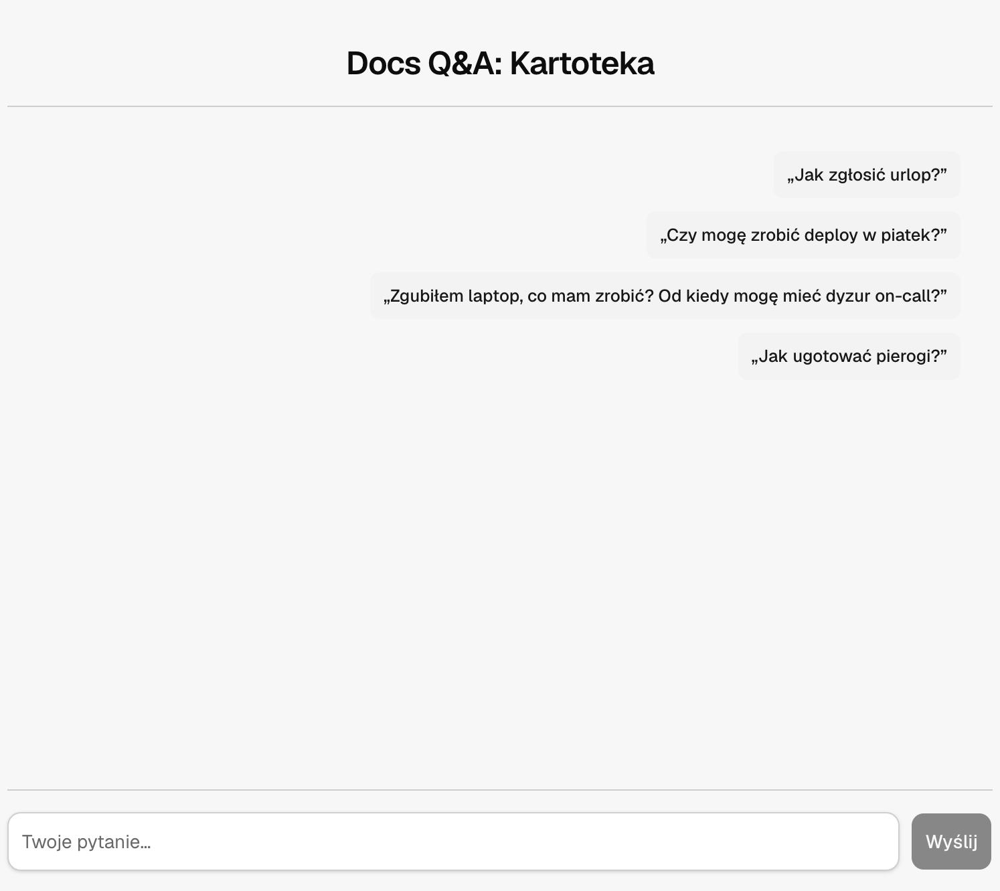

# Docs Q&A: Kartoteka

A RAG (retrieval-augmented generation) app that answers questions about internal company documentation and cites its sources. The documents describe **Kartoteka**, a fictional software company (leave policy, deployment process, on-call, security, remote work). The UI and the documents are in Polish.

The model answers **only from retrieved fragments**. If nothing relevant is found, it says so instead of guessing.

<!-- Live demo: https://… -->
<!--  -->

## Features

- Streaming answers with numbered citations (`[1]`, `[2]`) linked to collapsible source fragments (file, section, similarity score)
- Out-of-scope questions are rejected by a similarity threshold, before the LLM is called
- Section-aware Markdown chunking with overlap
- Retrieval evaluation script with configurable parameters
- Input validation (zod) and user-friendly error handling that never leaks provider details
- Example questions on the empty state, stop/retry controls, accessible live region for streamed answers

## Tech stack

Next.js (App Router) · React · TypeScript · Vercel AI SDK · OpenAI (embeddings + chat) · Tailwind CSS · shadcn/ui · zod · react-markdown

## How it works

**1. Indexing (offline, `npm run index`)**
`scripts/index.ts` reads `data/docs/*.md`, splits each file into chunks (`lib/chunk.ts`), embeds them in batches and writes `data/index.json` together with the embedding model name.

- Chunks never cross `##` section boundaries; paragraphs are merged up to `maxChars` (1200) with a 200-character overlap.
- The section heading is prepended to each chunk's text, so a fragment like "4 days per year" still carries the context "on-demand leave".

**2. Retrieval (`lib/retrieve.ts`)**
The question is embedded with the same model used for indexing and compared with every chunk using cosine similarity. Chunks below `minScore` (0.45) are dropped and the top `topK` (4) are returned. If the index was built with a different embedding model than the app uses, the module throws on import, since mixing vectors from two models would silently produce meaningless scores.

**3. Generation (`app/api/chat/route.ts`)**
Retrieved fragments go into the system prompt (`lib/prompt.ts`) with instructions to answer only from them and cite them. Only the last 6 messages are sent to the model to limit token cost. Source metadata is attached to the assistant message at stream start, so the UI can render citations immediately.

### Why a JSON file instead of a vector database

For a few dozen chunks, exact brute-force search takes milliseconds. Vector databases pay off with thousands or millions of vectors, where approximate indexes (e.g. HNSW) trade a bit of accuracy for speed. Indexing is done by a script rather than on server start because embeddings are paid once, Vercel's filesystem is read-only at runtime, and the stored model name makes a stale index detectable.

## Getting started

```bash
npm install
cp .env.example .env.local   # add your OPENAI_API_KEY
npm run index                # build data/index.json (only needed after changing docs)
npm run dev
```

Open http://localhost:3000.

## Scripts

| Script                                                 | What it does                                            |
| ------------------------------------------------------ | ------------------------------------------------------- |
| `npm run dev`                                          | Start the dev server                                    |
| `npm run index`                                        | Chunk and embed `data/docs/*.md` into `data/index.json` |
| `npm run eval`                                         | Run the retrieval evaluation (see below)                |
| `npx tsx --env-file=.env.local scripts/search-test.ts` | Print top matches for a few ad-hoc questions            |

## Retrieval evaluation

`npm run eval` runs 15 questions from `data/eval.json` (12 answerable, 3 out-of-scope) and checks whether the expected source file is among the retrieved chunks. Out-of-scope questions pass when nothing is retrieved. Parameters can be overridden: `npm run eval -- --minScore 0.35 --topK 2`.

| minScore | topK  | maxChars | Hit rate  | Notes                                                    |
| -------- | ----- | -------- | --------- | -------------------------------------------------------- |
| **0.45** | **4** | **1200** | **15/15** | chosen                                                   |
| 0.35     | 4     | 1200     | 15/15     | lets in irrelevant chunks (0.37–0.44)                    |
| 0.55     | 2     | 1200     | 12/15     | drops correct answers scoring 0.53–0.55                  |
| 0.45     | 2     | 1200     | 15/15     | correct file always in top 2                             |
| 0.45     | 4     | 600      | 15/15     | more, smaller chunks; no gain                            |
| 0.45     | 4     | 2000     | 15/15     | identical to 1200 (sections are shorter than 1200 chars) |

The weakest correct top-1 match scores **0.53**; the strongest out-of-scope question scores **0.29**. `minScore = 0.45` sits between them with margin on both sides. `topK = 4` is kept (although 2 is enough for single questions) to leave room for multi-part questions, which this eval set does not cover. Typos and missing Polish diacritics ("zglosic", "piatek") don't noticeably affect retrieval.

## Error handling

`app/api/chat/route.ts` separates client errors from server errors:

| Situation                                                        | Status | Message shown to the user            |
| ---------------------------------------------------------------- | ------ | ------------------------------------ |
| Invalid JSON, wrong body shape (zod), empty or too long question | 400    | specific reason                      |
| OpenAI rejects the API key (401/403)                             | 503    | service temporarily unavailable      |
| OpenAI rate limit (429)                                          | 429    | too many requests, try again shortly |
| Anything else                                                    | 500    | generic server error                 |

- Upstream errors are **translated, not forwarded**: a 401 from OpenAI is a server misconfiguration, not an unauthenticated user, so the client gets 503.
- Full error details are logged server-side only; the browser never sees provider internals.
- Errors before streaming starts return an HTTP error response; errors during streaming are sent as an error event in the stream (`onError`), since the status code has already been sent.
- The client shows the error with a retry button (`regenerate()` from `useChat`).
- All user-facing texts live in `lib/strings.ts`.

## Project structure

```
app/
  api/chat/route.ts    chat endpoint: validation, retrieval, streaming
  page.tsx, layout.tsx
components/
  chat.tsx             chat UI (useChat)
  sources.tsx          collapsible source list
lib/
  chunk.ts             Markdown chunking
  retrieve.ts          embedding + cosine search
  prompt.ts            system prompt with retrieved context
  models.ts            chat and embedding models
  strings.ts           UI and API texts
  types.ts             shared types (Source, ChatMetadata)
scripts/
  index.ts             build the embeddings index
  eval.ts              retrieval evaluation
  search-test.ts       ad-hoc retrieval check
data/
  docs/                source documents (Markdown)
  index.json           generated embeddings index
  eval.json            evaluation questions
```

## Known limitations

- **Very short queries.** Single words with several meanings (e.g. "zwolnienie": dismissal or sick leave) produce weak embeddings and may fall below `minScore` even when the docs cover the topic.
- **Multi-part questions.** Several questions in one message are embedded as one vector; this works when one document covers all topics but degrades when they are spread across files.
- **Oversized paragraphs are not split.** A single paragraph longer than `maxChars` becomes one oversized chunk. Fine for the demo docs; a fix would split such paragraphs on sentence boundaries.
- **In-memory JSON index.** Brute-force search over `data/index.json` imported into the server bundle doesn't scale to thousands of documents. Next step: Postgres + pgvector with an approximate nearest-neighbour index.
- **No rate limiting.** A public demo with a server-side API key can be abused. Current mitigation: a spending limit in the OpenAI dashboard. Next step: per-IP limits (e.g. Upstash Ratelimit).
- **Limited conversation memory.** Only the last 6 messages are sent to the model, and retrieval uses only the latest question, so follow-ups like "and on Thursday?" may retrieve poorly.
